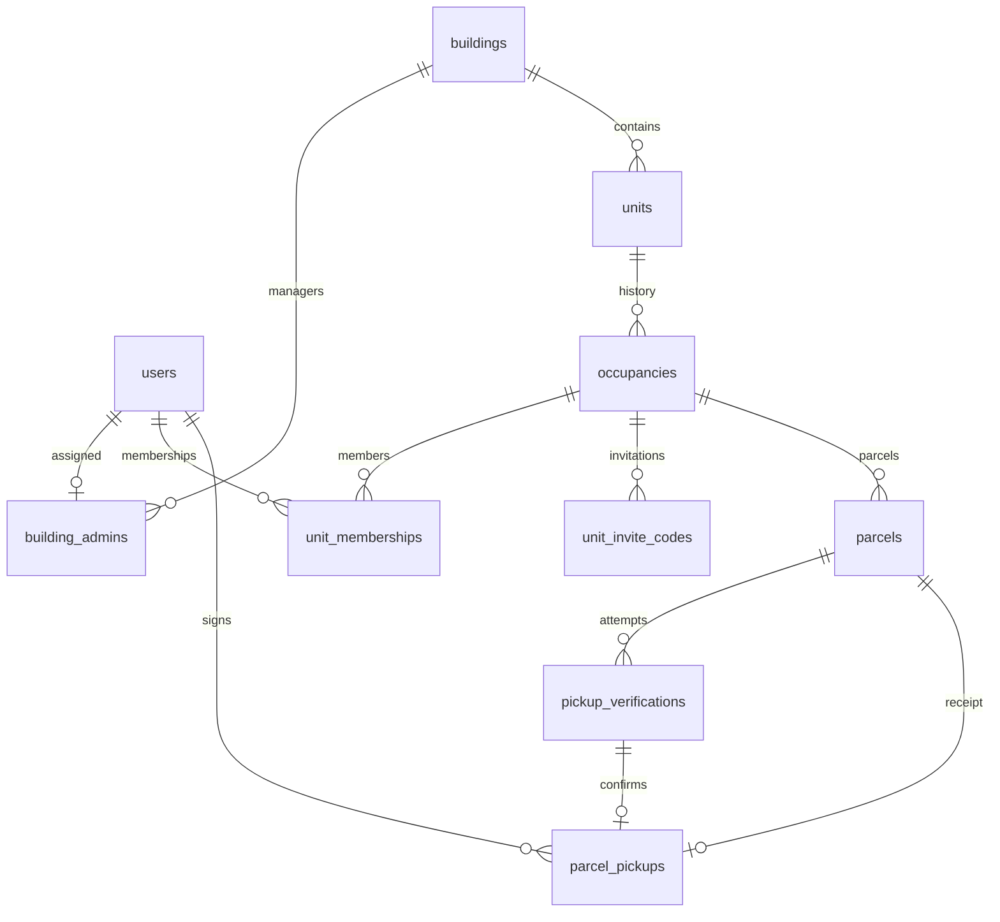

# 大樓包裹管理系統：MySQL 資料表初步設計與規則

更新日期：2026-10-10

商業行為以 [商業邏輯](business-rules.md) 為依據，待確認事項見 [問題清單](open-questions.md)。發現不一致先詢問使用者。

10 張業務資料表與技術支援表已依 D-26 完成建表與後端驗收；實際 SQL 為 migrations 001～013，schema_migrations 另由升級程式管理。本文件保留商業用途與設計依據，前端／串接完成狀態以開發計畫為準。

已實作資料表的欄位、索引與限制，以 backend/app/migrations/ 的 SQL 檔為準；本文件保留用途與商業規則，不重複列出技術支援表的欄位。

## 1. 系統範圍與共通規則

- 技術規劃：前端 TypeScript、React、Next.js；後端 FastAPI、MySQL。
- 三種角色：系統管理員、大樓管理員、住戶；第一版一個帳號只有一種角色。
- 登入使用 Email＋密碼；電話作為聯絡資料，不做手機驗證碼登入。
- 系統管理員建立大樓、建立大樓管理員帳號並分配管理範圍。
- 一棟大樓可有多位管理員；每位大樓管理員同時間只負責一棟大樓。
- 住戶以有效邀請碼加入戶別，不另設住戶人工審核流程。
- 一個住戶帳號同時間只屬於一戶；等待退出期間仍占用該資格。
- 同戶同批次的有效成員可共同查看與領取該批次包裹。
- 同一家人或室友新增成員沿用同一入住批次；整戶換人則建立新批次。
- 搬離者及新批次住戶均不可查看舊批次資料；管理員仍可查詢所屬大樓的歷史紀錄。
- 取消戶別資格不等於停用登入帳號。
- 表格中的「非必填」代表可為 NULL；事件發生時仍可能依規則要求填入。
- 日期欄位的時區與精度尚待統一，後續前後端須採一致約定。

## 2. 資料表總覽

| 資料表 | 用途 | 討論狀態 |
|---|---|---|
| `users` | 帳號、角色與個人資料 | 已確認 |
| `buildings` | 大樓基本資料 | 已確認 |
| `building_admins` | 管理員負責的大樓 | 已確認 |
| `units` | 大樓的樓層與戶號 | 已確認 |
| `occupancies` | 同一戶前後不同批住戶 | 已確認 |
| `unit_memberships` | 帳號的入住資格與退出紀錄 | 已確認 |
| `unit_invite_codes` | 加入入住批次的邀請碼 | 已確認 |
| `parcels` | 包裹、取件碼與最近一次異常處理 | 已確認 |
| `pickup_verifications` | 管理員驗證後等待住戶確認的流程 | 已確認 |
| `parcel_pickups` | 成功簽收結果 | 已確認草案 |

## 3. users：使用者

| 欄位 | 型別 | 必填 | 說明 |
|---|---|---|---|
| `id` | BIGINT | 是 | 主鍵、自動增加 |
| `name` | VARCHAR(100) | 是 | 姓名 |
| `email` | VARCHAR(255) | 是 | 登入帳號，不可重複 |
| `password_hash` | VARCHAR(255) | 是 | 密碼雜湊，不存原始密碼 |
| `phone` | VARCHAR(20) | 是 | 聯絡電話，文字型別保留開頭的 0 |
| `role` | VARCHAR(20) | 是 | 帳號角色 |
| `is_active` | BOOLEAN | 是 | 帳號是否啟用，預設啟用 |
| `created_at` | DATETIME | 是 | 建立時間 |
| `updated_at` | DATETIME | 是 | 最後修改時間 |

### 規則

- `role` 限定為 `system_admin`、`building_admin`、`resident`。
- 住戶自行註冊時固定為 `resident`，不能自行選管理員角色。
- 大樓管理員由系統管理員建立；第一個系統管理員由專案初始化建立。
- 姓名與電話可修改；更換戶別透過退出、使用新邀請碼加入處理。
- 大樓與戶號不存於本表，分別透過管理員分配、住戶資格關聯。
- 搬離只取消戶別資格，不直接將 `is_active` 設為停用。

## 4. buildings：大樓

| 欄位 | 型別 | 必填 | 說明 |
|---|---|---|---|
| `id` | BIGINT | 是 | 主鍵、自動增加 |
| `name` | VARCHAR(100) | 是 | 大樓名稱 |
| `address` | VARCHAR(255) | 是 | 大樓地址 |
| `phone` | VARCHAR(20) | 否 | 管理室聯絡電話 |
| `created_at` | DATETIME | 是 | 建立時間 |
| `updated_at` | DATETIME | 是 | 最後修改時間 |

### 規則

- 系統管理員建立及管理大樓；大樓管理員只能修改自己負責大樓的基本資料。
- 名稱可重複，以 `id` 區分；畫面搭配地址辨識。
- 管理員、樓層、戶號分別由其他資料表記錄。
- 只有系統管理員可刪除沒有管理員分配、戶別及任何業務紀錄的大樓；有任一關聯資料時拒絕刪除，不連帶刪除關聯資料。 使用既有交易鎖及外鍵限制，無須變更資料表。

## 5. building_admins：管理員分配

| 欄位 | 型別 | 必填 | 說明 |
|---|---|---|---|
| `id` | BIGINT | 是 | 主鍵、自動增加 |
| `user_id` | BIGINT | 是 | 外鍵 → users.id |
| `building_id` | BIGINT | 是 | 外鍵 → buildings.id |
| `created_at` | DATETIME | 是 | 分配時間 |

### 規則

- 一棟大樓可有多位管理員，例如早班、晚班各自使用帳號。
- 每位管理員同時間只負責一棟，因此 `user_id` 不可重複。
- 只能分配角色為 `building_admin` 的帳號。
- 系統管理員新增、變更或取消分配；取消後即不能管理原大樓。
- 過去經手的包裹與簽收紀錄保留，透過使用者 ID 追溯。
- 本表目前只表示現行分配，不包含管理員調任歷程。

## 6. units：戶別

| 欄位 | 型別 | 必填 | 說明 |
|---|---|---|---|
| `id` | BIGINT | 是 | 主鍵、自動增加 |
| `building_id` | BIGINT | 是 | 外鍵 → buildings.id |
| `floor` | VARCHAR(20) | 是 | 樓層，例如 3F、B1 |
| `unit_number` | VARCHAR(20) | 是 | 戶號，例如 301、3A |
| `created_at` | DATETIME | 是 | 建立時間 |
| `updated_at` | DATETIME | 是 | 最後修改時間 |

### 規則

- 同棟大樓戶號不可重複：`building_id`＋`unit_number` 組合唯一。
- 不同大樓可有相同戶號。
- 樓層與戶號使用文字，容納字母命名。
- 第一版不另建樓層表，新增戶別時填寫樓層。
- 搬離時保留戶別，人員更替由入住批次記錄。

## 7. occupancies：入住批次

| 欄位 | 型別 | 必填 | 說明 |
|---|---|---|---|
| `id` | BIGINT | 是 | 主鍵、自動增加 |
| `unit_id` | BIGINT | 是 | 外鍵 → units.id |
| `started_at` | DATETIME | 是 | 本批住戶開始使用戶別的時間 |
| `ended_at` | DATETIME | 否 | 結束時間；NULL 表示目前有效 |
| `created_at` | DATETIME | 是 | 資料建立時間 |

### 規則

- 每戶同時間只能有一個有效批次。
- 家人、室友加入沿用目前批次；個別成員搬離只取消該成員資格。
- 整戶換人時，管理員結束舊批次、取消舊成員資格、停用舊邀請碼，再建立新批次。
- 舊包裹保留原批次歸屬，不因戶別換人而轉給新住戶。
- 舊住戶尚有未領包裹時，先列為待處理，不能直接分給新批次。
- 同批次晚加入的家人可查看該批次包裹，不單靠加入日期過濾。
- 畫面可使用「建立入住」「結束入住」名稱，不要求住戶理解批次概念。

## 8. unit_memberships：住戶資格

| 欄位 | 型別 | 必填 | 說明 |
|---|---|---|---|
| `id` | BIGINT | 是 | 主鍵、自動增加 |
| `user_id` | BIGINT | 是 | 外鍵 → users.id，住戶帳號 |
| `occupancy_id` | BIGINT | 是 | 外鍵 → occupancies.id |
| `status` | VARCHAR(20) | 是 | 資格狀態 |
| `joined_at` | DATETIME | 是 | 成功加入時間 |
| `exit_requested_at` | DATETIME | 否 | 退出申請時間 |
| `left_at` | DATETIME | 否 | 正式取消資格時間 |
| `revoked_by` | BIGINT | 否 | 外鍵 → users.id，取消資格的管理員 |

| 狀態 | 意思 | 可查看所屬批次包裹 |
|---|---|---|
| `active` | 有效成員 | 可以 |
| `exit_requested` | 等待管理員確認退出 | 可以 |
| `revoked` | 已取消資格 | 不可以 |

### 規則

- 每位住戶同時間只能有一筆 `active` 或 `exit_requested` 資格。
- 有效邀請碼加入後直接成為 `active`，不再人工審核。
- 管理員確認搬離後，改為 `revoked`，填入 `left_at`、`revoked_by`。
- 管理員也能直接取消已搬離者資格，不必等住戶提出申請。
- 舊資格保留；日後重新入住新增資格紀錄。
- 查看包裹時，除了資格有效，也須確認入住批次未結束、帳號已啟用。
- 第一版退出申請直接記錄於本表，不另建申請表。

## 9. unit_invite_codes：戶別邀請碼

| 欄位 | 型別 | 必填 | 說明 |
|---|---|---|---|
| `id` | BIGINT | 是 | 主鍵、自動增加 |
| `occupancy_id` | BIGINT | 是 | 外鍵 → occupancies.id |
| `code_hash` | VARCHAR(255) | 是 | 邀請碼雜湊，用於驗證 |
| `expires_at` | DATETIME | 是 | 有效期限 |
| `disabled_at` | DATETIME | 否 | 手動停用時間 |
| `created_by` | BIGINT | 是 | 外鍵 → users.id，產生碼的管理員 |
| `created_at` | DATETIME | 是 | 產生時間 |

### 規則

- 同批次可多人使用邀請碼，但同時間只保留一組有效碼。
- 管理員要求系統產生四位數字邀請碼，固定產生後24小時到期，首次交付給確認過的屋主或入住代表；管理員不設定期限。
- 住戶輸入後，確認大樓與戶號才加入。
- 原始邀請碼只在產生時顯示一次供複製；之後不能查回原碼。
- 重新產生時停用舊碼；已加入成員不受影響。
- 成員搬離時停用該批次舊碼，有需要再產生新碼。
- 有效條件須同時符合：未停用、未到期、所屬入住批次未結束。
- 邀請碼與包裹取件碼用途不同；邀請碼不是使用一次就失效。

## 10. parcels：包裹

### 基本欄位

| 欄位 | 型別 | 必填 | 說明 |
|---|---|---|---|
| `id` | BIGINT | 是 | 主鍵、自動增加 |
| `occupancy_id` | BIGINT | 是 | 外鍵 → occupancies.id |
| `recipient_name` | VARCHAR(100) | 是 | 包裹標示的收件人姓名 |
| `courier` | VARCHAR(100) | 否 | 物流公司 |
| `tracking_number` | VARCHAR(100) | 否 | 物流單號 |
| `storage_location` | VARCHAR(100) | 否 | 存放位置 |
| `note` | TEXT | 否 | 包裹備註 |
| `status` | VARCHAR(20) | 是 | 包裹狀態 |
| `pickup_code_encrypted` | VARCHAR(255) | 是 | 加密保存的取件碼 |
| `created_by` | BIGINT | 是 | 外鍵 → users.id，登記管理員 |
| `created_at` | DATETIME | 是 | 登記時間 |
| `updated_at` | DATETIME | 是 | 最後修改時間 |

### 異常處理欄位

| 欄位 | 型別 | 必填 | 說明 |
|---|---|---|---|
| `exception_reason` | TEXT | 否 | 拒收、破損等異常原因 |
| `exception_reported_by` | BIGINT | 否 | 外鍵 → users.id，登記異常者 |
| `exception_reported_at` | DATETIME | 否 | 異常登記時間 |
| `resolution_note` | TEXT | 否 | 處理結果 |
| `resolved_by` | BIGINT | 否 | 外鍵 → users.id，完成處理者 |
| `resolved_at` | DATETIME | 否 | 完成處理時間 |

| 狀態 | 意思 |
|---|---|
| `pending` | 待領取 |
| `picked_up` | 已完成簽收 |
| `exception` | 異常處理中 |
| `returned` | 已退回物流 |

### 規則

- 登記時確認戶別、入住批次與收件人，再產生取件碼；不能只靠戶號分給新住戶。
- 收件人與簽收者可不同，同批次有效成員可代領。
- 住戶需要重複查看取件碼，因此採加密保存，不能只保存不可逆雜湊。
- 管理員驗證成功後仍為 `pending`，等住戶確認才改為 `picked_up`。
- 確認完成後取件碼失效；不能僅驗證碼相符而忽略包裹狀態。
- `exception`、`returned` 包裹不能領取。
- 標記異常必填原因；確認可領取時填處理結果並回到 `pending`；實際退回後改為 `returned`。
- 異常的操作者與時間由系統記錄。
- 第一版只保留最近一次異常與處理結果，不保留完整異常歷程。
- 若未來需保留每次處理過程，再拆出異常紀錄表。

## 11. pickup_verifications：取件驗證

| 欄位 | 型別 | 必填 | 說明 |
|---|---|---|---|
| `id` | BIGINT | 是 | 主鍵、自動增加 |
| `parcel_id` | BIGINT | 是 | 外鍵 → parcels.id |
| `verified_by` | BIGINT | 是 | 外鍵 → users.id，驗證管理員 |
| `verified_at` | DATETIME | 是 | 驗證成功時間 |
| `expires_at` | DATETIME | 是 | 本次驗證有效期限 |
| `status` | VARCHAR(30) | 是 | 驗證狀態 |
| `updated_at` | DATETIME | 是 | 最後更新時間 |

| 狀態 | 意思 |
|---|---|
| `awaiting_confirmation` | 等待住戶確認收到 |
| `completed` | 住戶已完成確認 |
| `expired` | 超過確認期限 |
| `cancelled` | 管理員取消或因包裹狀態改變而取消 |

### 規則

- 驗證成功建立紀錄，有效時間先設為 10 分鐘。
- 同一包裹同時間只能有一筆等待確認的有效驗證。
- 10 分鐘是本次確認期限，不是取件碼本身的期限。
- 住戶收到實物後，以自己的登入帳號確認；後端重新檢查帳號、戶別資格、批次、包裹及驗證是否仍有效。
- 成功時一起完成：驗證改為 `completed`、包裹改為 `picked_up`、建立簽收紀錄，取件碼同時失效。
- 過期或取消不代表已領取，管理員須重新確認現場情況後再驗證。
- 包裹改為異常或退回時，取消尚未完成的驗證。

## 12. parcel_pickups：簽收紀錄（已確認草案）

本節欄位與規則已確認，後續納入正式建表與 API 規格。

| 欄位 | 型別 | 必填 | 說明 |
|---|---|---|---|
| `id` | BIGINT | 是 | 主鍵、自動增加 |
| `parcel_id` | BIGINT | 是 | 外鍵 → parcels.id，不可重複 |
| `verification_id` | BIGINT | 是 | 外鍵 → pickup_verifications.id，不可重複 |
| `picked_up_by` | BIGINT | 是 | 外鍵 → users.id，確認領取的帳號 |
| `picked_up_at` | DATETIME | 是 | 完成簽收時間 |
| `picked_up_by_name_snapshot` | VARCHAR(100) | 是 | 簽收完成時的簽收者姓名 |
| `handled_by_name_snapshot` | VARCHAR(100) | 是 | 簽收完成時的經手管理員姓名 |

### 已確認規則

- 一個包裹最多一筆成功簽收；一筆驗證最多對應一筆簽收。
- 簽收者由後端根據登入帳號取得，不接受前端自行指定。
- 簽收時間由系統產生。
- 經手管理員帳號 ID 透過驗證紀錄查詢，不重複保存；姓名則在簽收時保存快照，後續改名不改歷史。兩個姓名快照與簽收交易一起寫入。
- 簽收不提供一般修改或刪除，搬離後保留供管理員查詢。
- 畫面稱「簽收者」，代表完成電子確認的帳號，不宣稱系統能自行辨識現場拿走包裹的人。

## 13. 資料關聯

圖中呈現主要關聯；登記者、驗證者、處理者等使用者外鍵請以各表欄位為準。
入住批次、資格及驗證的「同時間只有一筆有效資料」是額外規則，不代表歷史只能存一筆。

## 14. 主要流程

### 加入戶別

1. 系統管理員建立大樓、管理員帳號並分配大樓。
2. 大樓管理員建立戶別與有效入住批次。
3. 管理員產生邀請碼，交付確認過的屋主或入住代表。
4. 住戶註冊、登入，輸入邀請碼，確認大樓戶號後加入。
5. 系統建立有效住戶資格。

### 取件簽收

1. 管理員確認包裹所屬批次，登記包裹並產生取件碼。
2. 有權限的住戶查看包裹，到櫃檯提供取件碼。
3. 管理員驗證，建立 10 分鐘有效的取件驗證紀錄。
4. 管理員交付包裹，住戶核對實物。
5. 住戶以自己的帳號確認領取。
6. 系統完成驗證、包裹狀態與簽收紀錄，取件碼失效。

### 搬離與整戶更替

1. 住戶提出退出，或管理員確認住戶已搬離。
2. 取消住戶資格，填入時間、操作者，停用可能持有的舊邀請碼。
3. 其他同批次有效成員仍可使用；需要時產生新邀請碼。
4. 整戶更替時結束舊批次，取消舊成員資格，建立新批次。
5. 舊包裹與紀錄留在舊批次，不開放新住戶查看。

### 流程整體核對：已確認的補充規則

#### 加入戶別

- 加入者須已登入、帳號啟用且角色為住戶。
- 邀請碼須存在、未到期、未停用，且所屬入住批次尚未結束。
- 住戶不能已有其他有效或等待退出的戶別資格。
- 已加入同批次時，顯示「你已加入此戶別」，不重複新增資格。
- 顯示大樓戶號後，按下「確認加入」時仍須重新檢查邀請碼與資格。
- 最後檢查與新增資格須在同一次受保護的交易中完成，避免兩個分頁同時加入不同戶別。

#### 整戶搬離

- 管理員先檢查舊批次的未領包裹，再確認結束入住。
- 結束舊批次、取消所有舊成員資格、停用舊邀請碼、取消未完成取件驗證，須一起成功或一起失敗。
- 舊批次待領包裹改為 `exception`，原因記錄「原住戶已搬離，待處理」，並保留原批次歸屬；此更新也納入結束入住的交易。
- 已在異常處理中的未領包裹仍維持異常，補充搬離處理原因；已簽收或已退回者不重新改成異常。
- 第一版搬離後的未領包裹僅提供異常處理與退回物流，不提供原住戶回來領取的特殊流程。
- 後端須阻擋這類包裹恢復為可領取狀態，避免繞過已結束入住的限制。
- 舊批次結束後才建立新批次、產生新邀請碼；新住戶不可查看舊批次資料。
- 個別成員搬離不結束整個批次，其他同批次有效成員仍保有資格。

#### 取件驗證與簽收

- 管理員驗證時，須確認包裹屬於自己負責的大樓，狀態為 `pending`。
- 同包裹同時間只有一筆有效驗證，有效時間為 10 分鐘。
- 住戶收到實物後按下確認，後端再次核對登入帳號、資格、批次、包裹狀態及驗證期限。
- 簽收紀錄的驗證必須屬於同一個包裹；簽收者必須是該包裹批次的有效成員。
- 包裹改為已領取、驗證改為完成、建立簽收紀錄須一起成功或一起失敗，完成後取件碼失效。
- 同一帳號重複送出已成功的確認請求時，不新增紀錄；仍須通過當下的存取權限檢查，才回傳原成功結果。
- 同戶兩人同時確認，只允許一人成功；另一位仍具查詢權限的成員看到「此包裹已完成簽收」。
- 以上規則需由後端與資料庫交易保證，不能只靠前端停用按鈕。

## 15. 正式建表前待核對事項

以下是實作前須補齊的事項，不表示已增加已確認功能。

- 統一時間時區、字元集、定序、主鍵與外鍵型別。
- 決定如何在資料庫與交易中保證「每戶一個有效批次」「每人一筆有效資格」「每批次一組有效邀請碼」「每包裹一筆有效驗證」。單靠前端判斷不足。
- 確認邀請碼雜湊的查找方式，以及取件碼加密、查找、碰撞處理與唯一範圍；目前欄位不是完整安全方案。
- 確認加密後長度是否符合取件碼欄位大小。
- 簽收時保證驗證所屬包裹與 `parcel_pickups.parcel_id` 一致，並防止重複簽收。
- 取件確認的三項更新須一起成功或一起失敗；退出、邀請碼失效、入住結束也須避免部分完成。
- 異常再次發生時清空前次處理結果，按 BR-08 記錄最近一次操作者與時間，正式 SQL 及測試須落實。
- 已確認保留簽收當時姓名，正式 SQL 與 API 必須使用本表兩個姓名快照欄位；其他歷史顯示資訊依Q-10使用目前關聯值，不新增快照。
- Swagger 已按三階段及姓名快照同步；Q 清單後續決議仍須同步欄位、流程及驗收。

## 16. 後續開發順序

以 [開發順序與驗收](development-plan.md) 為準，取代舊有先建全部資料表及四階段 API 的排程。

1. 確認商業邏輯及功能文件，逐項解決待確認問題。
2. 依 D-26 先完成剩餘 DB／後端與測試：大樓與管理員 → 戶別入住 → 邀請碼加入 → 包裹 → 取件簽收 → 異常 → 搬離更替。
3. 使用者依相同順序製作前端，再進行串接與本機整體驗收。

## 17. 本次決議對資料設計的要求

- 邀請碼是四位數字字串，保存查找雜湊，全系統有效碼不重複；期限由後端固定為產生時間加24小時。舊碼停用、新碼建立與唯一性檢查使用交易。碼空間滿時不能產生重複碼或先破壞現有有效碼；具體實作於T-02、03補齊。
- 取件碼六位數字，同棟有效碼唯一。兩種碼以帳號及用途分別累計失敗次數，連錯5次暫停對應驗證5分鐘；邀請碼的驗證與加入共用計數。技術保存方式依T-04設計，不能靠前端記憶。
- 登入自成功起8小時有效，需能只撤銷目前裝置登入；T-04補足登入資料或技術支援表，不可藉由只清Cookie宣稱後端登入已撤銷。
- 物流公司與單號不加禁止重複的唯一限制。新增時比對同棟完整物流公司及單號，先提示，明確確認後可新增；缺任一值不比對。
- 包裹任何實際更正都取消等待驗證；更改入住歸屬才因該次更正換碼。更正與取消使用同一交易，防止簽收舊資料。
- 管理員列表使用users與building_admins關聯，需含尚未分配者，不為列表新增重複姓名表。前端傳user_id，操作仍由後端檢查角色與大樓限制。
- 取消資格者日後取得新有效碼可建立新資格，不增加封鎖表；原有一人一戶與歷史隔離規則維持。
- 只有簽收者、經手管理員姓名保存當時值；大樓名稱、樓層、戶號、收件人、物流、單號均使用目前關聯值。
- 已交付未簽收使用既有異常欄位追蹤，管理員不得寫入成功簽收代替住戶；原資格與狀態限制仍適用。

上述業務表已依 D-26 實作；下方補充已驗收的技術設計。

### 2B～3D 技術實作（2026-10-15，D-26）

- 004～012 建立其餘 9 張業務表；013 為按帳號／用途分開的 `code_attempts`。外鍵阻止無效關聯，生成欄位唯一鍵確保同戶只有一個有效入住、同帳號一個有效資格、同包裹一筆等待驗證。
- 每個資料庫使用一把 `GET_LOCK` 業務鎖（最長等候 10 秒）；權限、資料變更、回應查詢同一交易。鎖在 commit／rollback 後釋放。使用者取消分配、撤銷、整戶結束與簽收使用同一序列化規則；獨立測試庫使用不同鎖名。
- 邀請碼以 HMAC-SHA256 查找；不保存可還原原碼。`released_at` 只釋放已到期碼的唯一鍵占位，不冒充手動停用；API 依到期／停用／入住狀態推導 active／expired／inactive。
- 取件碼以 cryptography Fernet 加密，另保存帶金鑰的用途雜湊供查找；同大樓 pending 包裹的查找值唯一。恢復／更正入住時排除原碼，確保換碼。一般回應模型不包含雜湊、密文或生成欄位。
- `CODE_ENCRYPTION_KEY` 由環境提供，不進 Git。首次本機設定由 `configure_local_key.py` 產生，已有值不覆寫；必須與資料庫一起備份，不能在重啟時隨機換鍵。
- 邀請與取件各自累計連錯；第五次回傳 429 並保存 5 分鐘 blocked_until，有效成功清除該用途計數，其他用途與帳號不受影響。錯誤計數使用真實資料庫，跨程序一致。
- 時間儲存 UTC DATETIME(6)、回應含 UTC 時區；簽收日期篩選使用臺灣日界且包含迄日。交易及回應欄位驗收見開發計畫。
- 目前以本機 MVP 一致性為優先；清單及全域業務鎖尚未做大量資料／高併發壓測，後續擴充可在相同交易測試下細分鎖與調整查詢。

### 2A 技術資料表與安全設定（2026-10-15）

- `001_users.sql`：帳號、Argon2id 密碼雜湊、Email 唯一鍵；Email 去頭尾空白並轉小寫，姓名 1～100、電話 8～20 字元。MySQL utf8mb4、時間使用 UTC。
- `002_auth_sessions.sql`：以隨機登入憑證的 SHA-256 雜湊為主鍵，保存 user_id、created_at、expires_at、revoked_at；8 小時絕對期限，每次受保護請求重新檢查憑證及帳號啟用。登出只撤銷本次登入。
- `003_auth_rate_limits.sql`：bucket_hash、window_start、attempts；IP 與正規化 Email 各自分桶，交易鎖定下計數。登入每 5 分鐘 20 次、註冊每小時 10 次，含成功請求；超限回傳 429 及 Retry-After。這是帳號防濫用技術設定，與 Q-05 邀請／取件碼規則分開。
- `schema_migrations` 記錄版本、checksum、狀態；重跑略過成功版本，已套用來源變動或未完成版本會停止，不覆寫既有資料。
- 寫入 API 檢查 Origin 白名單；Cookie 使用 HttpOnly、SameSite=Lax、Path=/，預設 Secure，本機 HTTP Compose 明確關閉 Secure。API 回應不快取。
- 首位系統管理員由 `python -m app.bootstrap_admin` 互動初始化；命名鎖避免重複建立，重跑不覆寫密碼，不將既有住戶升權。
- D-25：`/me` 的兩個關聯陣列在 2A 為階段空值，不代表真實資格查詢已實作；2B／2D 必須替換並驗收。
